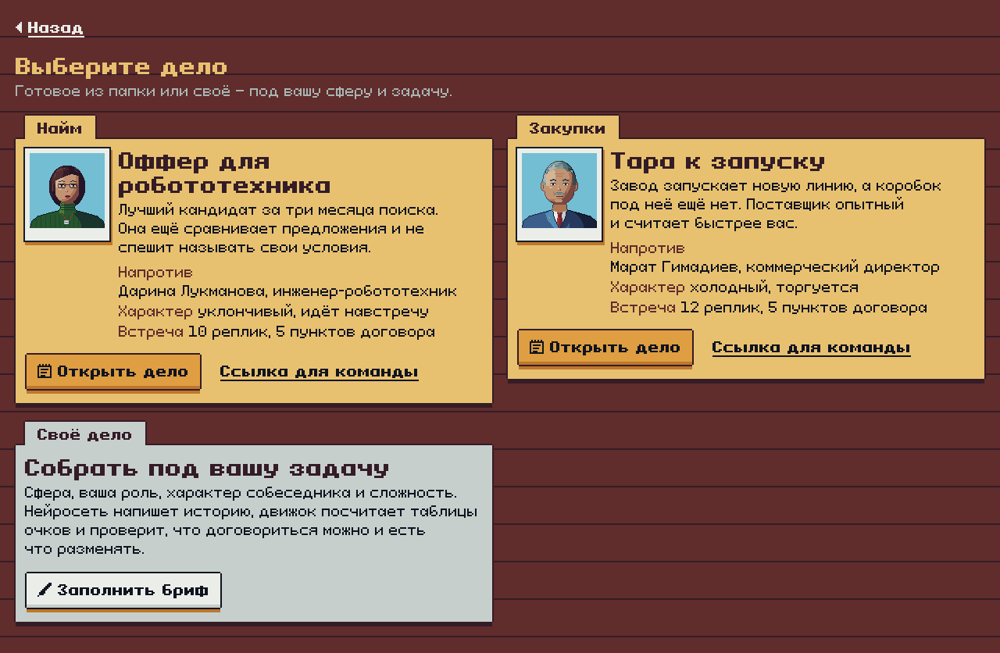
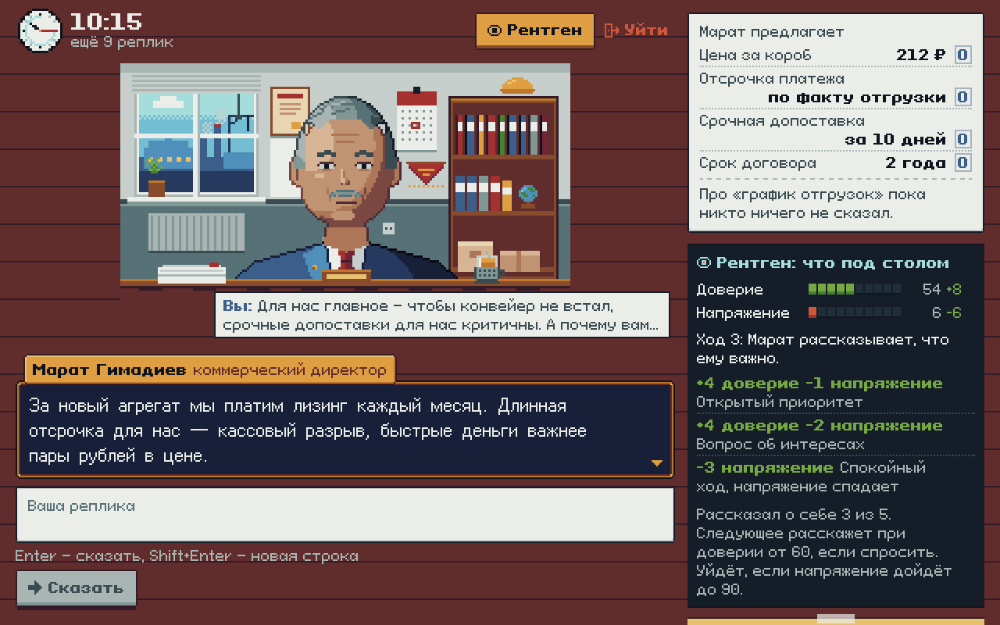
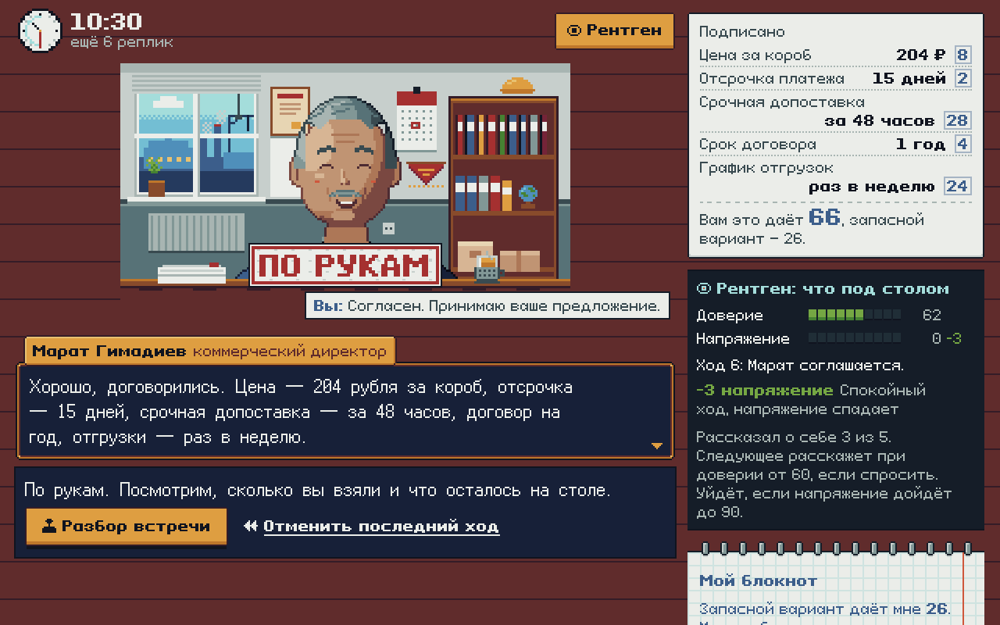
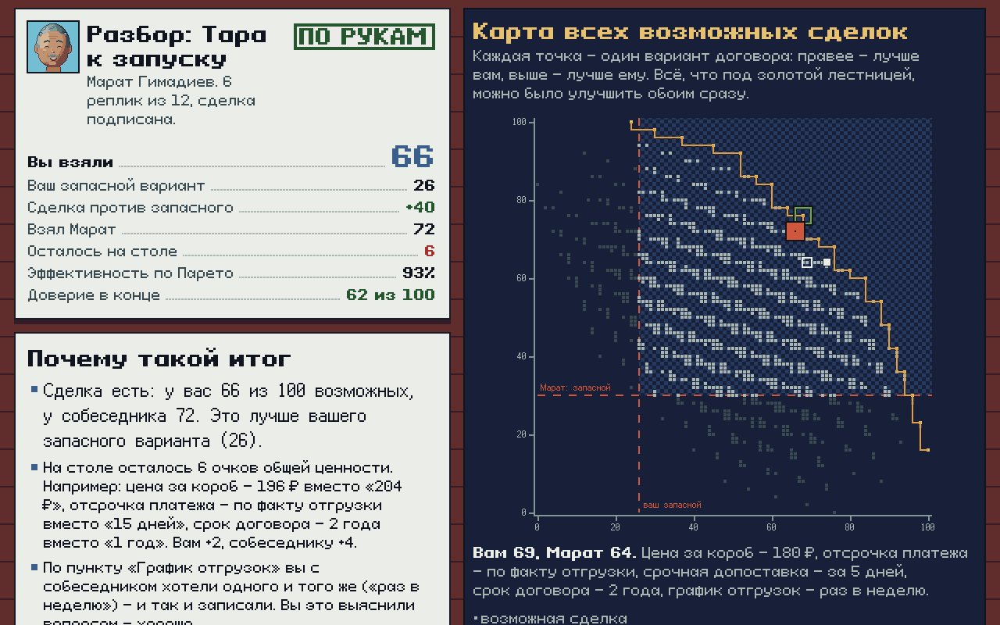

# Переговорка

Пиксельная игра, где вы ведёте деловые переговоры с персонажем, а после встречи смотрите разбор: сколько взяли и где можно было взять больше. Для сотрудников, которым надо потренироваться в закупках, продажах или найме, не рискуя настоящей сделкой, и для HR, которые дают команде одно дело по ссылке и видят результаты на одной доске. Кейс №9 ОЭЗ «Алабуга», ЛЦТ 2026.

**Скринкаст, 3 минуты:** https://arena-peregovorov.ru/screencast.mp4 (открывается без пароля; файл в репозитории — [public/screencast.mp4](public/screencast.mp4)). Сюжет, настройка своего дела, встреча в 3D с разбором хода и рентгеном, разбор с картой сделок и перемоткой, кабинет руководителя.

Для кого это, какую проблему решает, как внедрить в компании, сколько стоит, что мерить на пилоте и где границы MVP — в [docs/product.md](docs/product.md).



## Как попробовать

Демо: **https://arena-peregovorov.ru** (реплики игрока размечает YandexGPT 5.1 Pro, собеседника играет Claude Sonnet 5.5, говорит он голосом ElevenLabs, запасной голос — SpeechKit). Прототип закрыт от посторонних: эксперты входят по ссылке с ключом из формы сдачи или по логину и паролю оттуда же. Проверено в Chrome и Safari последних версий, на ноутбуке и на телефоне. Микрофон нужен только для голосового ввода.

Жюри удобнее начать с кнопки «Для жюри» на титуле (или сразу https://arena-peregovorov.ru/?jury). Там четыре шага:

1. «Настроить» — своё дело: сфера, роли и цели сторон, характер, сложность.
2. «Провести» — встреча по делу «Тара к запуску».
3. «Разбор» — готовая встреча, её за секунду сыграл движок.
4. «Команда» — кабинет руководителя: ссылка команде и доска результатов.

Локально нужен Node.js 22:

```sh
npm ci
npm run dev        # игра на http://localhost:5173, API на :8787
```

Ключи не обязательны. Без `.env` игра работает офлайн: реплики игрока разбирают правила, собеседник отвечает заготовками (`npm run dev:offline` — то же явно). С моделями и голосом скопируйте `.env.example` в `.env`, там все настройки с комментариями. Главное:

```sh
LLM_PROVIDER=yandex
YANDEX_API_KEY=...                 # YandexGPT и SpeechKit
YANDEX_FOLDER_ID=...
YANDEX_ANALYZE_MODEL=yandexgpt-5.1 # разметка на Pro
AITUNNEL_API_KEY=...               # реплика — Claude Sonnet 5.5; без ключа пишет YandexGPT
TTS_PROVIDER=elevenlabs            # голос ElevenLabs через свой воркер; без него — SpeechKit
ELEVEN_RELAY_URL=...
ELEVEN_RELAY_SECRET=...
```

Модель не ответила или ключ неверный — ход доигрывается запасным путём (YandexGPT, потом правила и заготовки), игра не останавливается.

Кнопка «Голос» в шапке встречи озвучивает собеседника, кнопка с микрофоном рядом со «Сказать» переводит речь в текст (SpeechKit). Распознанное попадает в поле ввода, его можно поправить перед отправкой. Без ключа или при сбое кнопок голоса нет или звук просто не играет.

Как на проде: `npm run build && npm run build:server && npm start` — один процесс `node dist-server/server.mjs` отдаёт и фронт, и `/api`. Docker собирает тот же `server.mjs` без `node_modules` на `node:22-alpine`: `docker build -t arena . && docker run -p 8080:8080 arena`, ключи — через `--env-file .env`, без них офлайн. Тесты — `npm test`.

## Как устроена игра

**Два режима.** На титуле две кнопки. «Сюжет» ведёт неделю по порядку. В первый раз идёт пролог: новенький едет в автобусе вдоль Камы и листает памятку, в ней четыре мысли о переговорах, по одной на экран. Потом глава, разбор и «Дальше», то есть катсцена-переход к следующей главе с приёмом дня в телефоне. Катсцены длятся 18–40 секунд, клик переключает план, Esc пропускает. «Для жюри» (или сразу `/?jury`) открывает всё без катсцен. Сверху путь кейса за минуту: настроить своё дело, провести встречу, посмотреть разбор готовой встречи (её за секунду сыграл движок в браузере). Ниже любая глава, дела из папки и их жёсткие версии, кабинет руководителя, настройки (наставник, подсказки, голос, как отвечать: голосом или текстом, пауза до отправки) и все катсцены. Катсцены нарисованы 2D-пикселем в палитре Apollo. Вечер, утро и ночь движок получает из дневных картинок: каждый цвет заменяется ближайшим цветом палитры (`src/game/cutscene/`, графика — `tools/art/cutscene_*.py`). Любую катсцену можно открыть ссылкой, например `/?cutscene=prologue`.

**Кампания «Новенький. Неделя в Алабуге».** Вся неделя видна на карте Елабуги и ОЭЗ. Вы новенький, приехали работать в особую экономическую зону, и у вас семь дней. Воскресенье — общага и сосед по комнате, понедельник — остановка у ларька и первая рабочая встреча, потом магазин у дома, рабочие дела и финал в бытовке цеха в ночь перед запуском линии. На каждой главе один приём: обмен, спокойствие и путь отступления, правила и факты вместо «я же прав» и так далее. Бытовые главы сыграны без делового пафоса, но движок и разбор у них те же, а рабочие главы — это дела из папки. Все точки карты открыты сразу, следующая по сюжету подсвечена, после главы на карте появляется «что было дальше». Главы и тексты лежат в `src/content/story.ts`, бытовые дела — в `src/content/scenarios/story/`. У каждого места своя 3D-комната: общага, остановка, магазин, кабинет закупок «Инея», бытовка (`src/game/world3d/rooms/`), и своя массовка.

1. **Дело.** Выберите одно из трёх готовых — по ступеньке сложности: «Оффер для робототехника» (найм), «Тара к запуску» (закупки), «Удержать клиента» (продажи, собеседник стоит до последнего) или соберите своё: сфера, ваша роль, характер собеседника, сложность, цели. Отдельно — дело на английском «The Istanbul Line» (ниже). Кнопка «Ссылка для команды» даёт адрес, по которому у всех будут одинаковые условия. Чтобы собрать результаты на одной доске, откройте тренировку через кабинет руководителя (ниже).
2. **Встреча.** В договоре пять пунктов. Вы видите только свою таблицу очков, у собеседника своя. Пункты бывают трёх видов:
   - делимые: цена или оклад, что одному плюс, другому минус;
   - разменные: одной стороне пункт важен, другой почти безразличен, и на них создаётся ценность;
   - совместимые: обе стороны хотят одного и того же, но об этом не знают.

   Встреча идёт от первого лица, в пиксельном 3D: вы сидите за столом, напротив собеседник и пара коллег, можно оглядеться мышью, стрелками или пальцем. Пишете свободным текстом, а условия целиком предлагаете из блокнота, который лежит перед вами на столе (стрелка вниз или кнопка «Стол»): стрелками выбираете варианты, справа видно, насколько каждый вам выгоден, внизу — «Предложить». Там же листок с условиями собеседника и кнопкой «Согласиться» и карточка «Под рукой»: «Что чувствует», голос, уход. На встречу даётся 10–12 реплик, время показывают часы на стене. «Что чувствует» (в коде — рентген) показывает доверие и напряжение собеседника и то, из-за какой реплики они изменились. Если WebGL нет или устройство не тянет, встреча сама идёт в запасном 2D-виде; выбирать вид игроку не нужно.

   Первая встреча обучающая: сначала видно только собеседника и поле ответа, потом наставник по одному показывает блокнот, «Предложить», листок собеседника, «Что чувствует» и уход — одна фраза и мигающая рамка на каждый шаг, «Я уже умею» пропускает всё. Принципы и словарь простых слов — в [docs/ux-onboarding.md](docs/ux-onboarding.md).

   После каждой реплики появляется разбор хода: что сработало (зелёным, с вашей цитатой), что помешало (красным), как ход сдвинул собеседника и что попробовать дальше. Плашки гаснут сами, целиком разбор открывается по «Подробнее». Считается из того же разбора реплики, что и итог, без второго запроса к нейросети, поэтому одинаково работает и офлайн. Для честного экзамена подсказки выключаются одной кнопкой.
3. **Разбор.** Сверху три строки: итог, что получилось, что попробовать в следующий раз. Ниже финал и прокачанные навыки, а в «Подробном разборе» — цифры, карта всех возможных сделок, счёт собеседника и три ключевых момента с цитатами. С любого из этих моментов встречу можно переиграть.
4. **Карьера.** Звёзды и открытые финалы дают звание (от «Стажёра» до «Зовут на сложные встречи»), приёмы из реплик растят четыре навыка: выгода для обоих, своя выгода, отношения, ход разговора (по Lax & Sebenius — создание и присвоение ценности, отношения, процесс). Всё это видно в «Личном деле» вместе с лучшим результатом по каждому делу и советом, что сыграть дальше. После первой сделки у дела появляется «Сыграть жёстче»: та же история, но собеседник уступает медленнее и откровенничает при доверии на 10 выше (`?case=tara-hard`). Ничего не заперто, любое дело открыто сразу.



**Дело на английском.** «The Istanbul Line» (в хабе жюри — карточка «🇬🇧 English: поставщик из Стамбула», `/?case=istanbul`): завод в ОЭЗ покупает линию порошковой покраски у экспорт-менеджера из Стамбула Эмре Кая. Торг по пяти пунктам — цена в евро, предоплата, срок поставки, гарантия, обучение операторов, — со скрытыми интересами, запасными вариантами сторон и ловушкой: обучение на месте нужно обоим. Всё, что звучит за столом, — по-английски: бриф, вступление, реплики, голос (ElevenLabs, английский с лёгким турецким акцентом; запасной — SpeechKit john), распознавание речи (Scribe и SpeechKit en-US), эпилоги. Интерфейс, подсказки на полях и разбор — по-русски, цитаты игрока — как сказал. Разметку английских реплик ведёт Claude Sonnet 5.5 (`ANALYZE_LLM_EN`): на 14 трудных репликах он верен в 97–100%, YandexGPT Pro — в 94% и дважды ломал JSON. Без модели английский понимают правила: «€450,000», «450k», «four fifty», «30% upfront», «fifty-fifty», «two weeks», «net 30», «deal», «no way», «I'm leaving».

## Для компании: тренировка команды

Вход «Для руководителя» есть в хабе «Для жюри» (шаг «Команда») и внизу папки дел. Сценарий такой:

1. Руководитель (тренер, HR) выбирает дело из папки или собирает своё и называет тренировку, например «Отдел закупок, октябрь».
2. Получает две ссылки. Ссылку для команды отправляет в рабочий чат. Вторая ссылка, на доску результатов, остаётся у него.
3. Участник открывает ссылку, вписывает имя или ник и играет. После разбора результат сам уходит в журнал тренировки. Переигрывать можно, на доске хранятся первая, лучшая и последняя попытки.
4. На доске видно ведомость с сортировкой (очки против запасного, Парето, доверие, финал, звёзды, время, попытки), чем кончилось у команды по восьми финалам, средний профиль поведения против эталона Rackham и типичные ошибки: слабые привычки, которые повторяются у нескольких человек, и сколько человек не нашли общий интерес. Выгрузка в CSV для Excel. Доска обновляется кнопкой.

Итог попытки сервер пересчитывает сам из истории ходов тем же движком, поэтому у всех одна мерка и результаты сравнимы. Комната — файл в `CACHE_DIR/rooms`, перезапуск сервера она переживает.

Ограничения MVP: аккаунтов нет, доступ к доске даёт секрет в ссылке. Кто получил ссылку на доску, видит результаты всех, а потерянную ссылку не восстановить, придётся открыть новую тренировку (с того же браузера открытые тренировки видны в кабинете). Участник подписывается как хочет, имя никто не проверяет. В комнате до 200 участников. Без сервера (офлайн-режим в браузере) кабинет и доска не работают и говорят об этом.

## Кто что решает

Решения принимает движок. Нейросеть на каждом ходу делает две отдельные вещи:

- **размечает реплику игрока** (YandexGPT 5.1 Pro): какие приёмы в ней есть, какое предложение сделано, не нарушен ли деловой тон. Температура 0, строгий JSON, ответ кэшируется. Без цитаты приём не засчитывается, условие — только если игрок сам назвал его словами;
- **играет собеседника внутри рамки движка** (Claude Sonnet 5.5 через AITunnel; не ответил за 8 с — пишет YandexGPT, дальше заготовка). Модель видит карточку персонажа, весь разговор и решение движка на этот ход. Закрытые причины собеседника она не видит, пока движок не разрешит их рассказать. Ответ проверяется: условия и согласие сверяются с решением движка, ловятся выдуманные цифры (в том числе между вариантами), выданные тайны, «рассказать причину» без причины, мат, путаница сторон. Не прошло — одна переписка, потом безопасный вариант, потом заготовка. Модель зависла три раза подряд — следующие 2 минуты ход идёт запасным путём.

Движок детерминированный. Он двигает доверие и напряжение по найденным приёмам и выбирает: принять, сделать встречное предложение, рассказать о своём интересе (если доверия хватает и игрок спросил), ответить человеку (игрок пошутил, извинился или спросил о жизни, а предложения нет — сделка стоит на месте; после двух таких ходов собеседник сам возвращает к делу), держать позицию, сделать замечание о тоне или уйти. Уступает оппонент по кривой Faratin: на лёгкой сложности быстро, на тяжёлой держится до конца. Ниже своей альтернативы не опускается никогда. Число рядом с вариантом на листке округляется в пользу собеседника, а число, которого на листке нет, предложением не считается; пункты, которые игрок не назвал, берутся с листка собеседника, только если он сам сказал «остальное как у вас». Раз одна и та же история ходов всегда даёт один и тот же итог, работает перемотка.



## Как считаем результат

Итог считает движок по трём счетам, модель в оценку не вмешивается.

1. **Сделка.** Ваши очки против вашей альтернативы (BATNA), эффективность по Парето и сколько ценности осталось на столе. Всё это считается по обеим скрытым таблицам. Если сделка хуже, чем просто уйти, это провал, даже когда все улыбались.
2. **Отношения.** С каким доверием собеседник уходит со встречи, сколько раз был нарушен тон и сколько своих интересов он успел рассказать.
3. **Поведение.** 17 наблюдаемых приёмов сравниваем с эталоном Rackham & Carlisle (1978), где сильных переговорщиков сравнивали со средними: вопросы об интересах, проверка понимания, размен «если… то…», раздражители, ультиматумы и так далее. Семнадцатый, «Личный контакт» (извиниться, пошутить к месту, спросить о человеке), опирается на более поздние работы, эталона Rackham у него нет.



Откуда взяты индикаторы, веса и пороги, как проверяются сценарии и чего мы не знаем, описано в [docs/research/method.md](docs/research/method.md). Там же ссылки на исследования и разбор игр-референсов. Короткая версия есть в самой игре под заголовком «Как мы считаем».

## Архитектура

```
браузер (React)                 сервер (Hono, Node 22)
  экраны, рентген,   ── /api ──▶  /api/turn:  разметка реплики ─┐   YandexGPT 5.1 Pro
  карта сделок                                                  ├─▶ движок (src/engine)
                                               реплика в рамке ◀┘   Claude Sonnet 5.5 (AITunnel)
                                  /api/report, /api/scenarios, /api/rooms,
                                  /api/scenario/generate
                                  /api/tts ── ElevenLabs (воркер Cloudflare) → запасной SpeechKit
                                  /api/stt ── SpeechKit
                                  кэш ответов на диске (CACHE_DIR, ключ — хэш входа)
```

- Движок (`src/engine`) — чистый TypeScript без случайности: таблицы очков, стратегия уступок, доверие и напряжение, отчёт. Там же офлайн-разметчик на правилах и шаблонные реплики.
- Сервер (`src/server`) — Hono. Провайдеры только `yandex`, `aitunnel` и `offline`; не поднялся провайдер — `offline`. Модели по задачам — `ANALYZE_LLM`, `ANALYZE_LLM_EN` (разметка дел на английском, по умолчанию Sonnet) и `VOICE_LLM`, `VOICE_LLM=main` — всё на Яндексе. Какая модель написала реплику, видно в `/api/health` (`voiceModel`) и в ответе `/api/turn` (`sources.voiceModel`).
- Своё дело. Нейросеть пишет историю, людей и варианты, а таблицы очков и BATNA строит движок. Потом он проверяет, что зона соглашения есть и размен выгоднее, чем делить всё пополам. Если проверка не прошла, модели дают ещё две попытки с замечаниями, после этого подбирается дело из библиотеки. В офлайн-режиме своё дело сразу подбирается из библиотеки.
- Кэш. Одинаковый ход даёт тот же ответ даже после перезапуска, если `CACHE_DIR` лежит на постоянном диске.
- Скорость хода (замеры — `~/Arena-materials/final/SPEED_REPORT.md`, `scripts/speed-bench.ts`, `scripts/speed-e2e.ts`). Игра просит ход потоком (`stream: true`): сервер присылает строку `line` — начало реплики и ссылку на живой звук `/api/tts/live/…` — раньше, чем ход целиком (`done`). Модель реплики пишет сначала условия, согласие и раскрытые причины, потом текст: рамку проверяем по ним сразу и при нарушении обрываем; начало реплики после проверки сразу уходит в ElevenLabs, остаток синтезируется следом и приклеивается. Пока Pro размечает ход, реплику уже пишет модель по разбору правил; рамка та же — берём её (`SPECULATE=off` — выключить). Браузер играет звук с первых байт (MediaSource), текст печатается вместе со звуком; ответа нет 0,6 с — фраза-пауза.
- Голос. Основной — ElevenLabs v4 Turbo через свой воркер Cloudflare: ключ ElevenLabs живёт только в воркере, браузер к ElevenLabs не ходит. У каждого лица свой голос, seed и stability 0,6 (`CAST` и `ELEVEN_TUNE` в `src/server/tts.ts`): у Тимура, Палыча, Ларисы Петровны, Розы и Дарины — дизайн-голоса, подобранные под портреты (18.10), у остальных — из библиотеки. Звук — mp3 128 кбит/с. Вступления, фразы-паузы и реакции записаны заранее на `eleven_v4` (`scripts/eleven-known.ts`, `scripts/reaction-voices.ts`). ElevenLabs озвучивает только тексты, которые выдал сам сервер: реплики хода, вступления дел, собранные дела. Лимиты: 60 синтезов в час на вход, 300 в сутки на пропуск, 20 000 символов в сутки на сайт, повторы из кэша бесплатны; очередь по потокам тарифа, на «занято» (429) один повтор. Лимит, очередь, ответ медленнее 2,5 с до первого байта или три сбоя подряд (пауза 5 минут) — говорит SpeechKit (у лиц свои livetts-голоса, ударения и паузы, `NATURAL_SPEECH=voices+`), опоздавший звук ElevenLabs ложится в кэш. Кто говорит сейчас, видно в `/api/health` → `speech.voice`. Голос OpenAI на проде запрещён и из кода убран.
- Ударения. Словарь `src/content/stress-dict.ts` и правила, омографы решает YandexGPT Lite (ждём 0,5 с). SpeechKit получает «+», ElevenLabs — знак ударения; англицизмы и сокращения пишутся так, как их говорят (вайфай, О-Э-З). Пометки для голоса (`[sighs]` и т. п.) ставит модель, на экране и у SpeechKit их нет (`src/server/tags.ts`); правила текста для ElevenLabs — `docs/research/eleven-text.md`.
- Распознавание — SpeechKit: браузер перегоняет запись в 16 кГц моно PCM (одинаково для Chrome и Safari), до 30 секунд. Попытка 8 с и один повтор, каждый запрос — строка в журнале сервера без текста речи.

## Что есть в MVP и чего нет

Есть: три проверенных дела по трём ступеням сложности, дело на английском и генерация своего, свободный текст или голос плюс блокнот с формальным предложением, озвучка собеседника, пять характеров и три уровня сложности, контроль делового тона, рентген, разбор каждого хода на полях, отмена хода, разбор с картой сделок и перемоткой, ссылка для команды, кабинет руководителя с доской результатов, офлайн-режим, вёрстка под телефон.

Нет: аккаунтов (доступ к доске по секретной ссылке), ручного редактора таблиц очков, переговоров человека с человеком, выгрузки в LMS.

## Если нейросеть отвечает шаблонами

На демо стоит общий лимит 6000 ₽ на все модели и голос (`LLM_TOTAL_RUB`). С 80% модели Яндекса переходят на YandexGPT Lite, со 100% собеседник говорит заготовками, а голос выключается. Игра при этом не ломается, и в ней появляется плашка с объяснением. Оценка от этого не меняется: очки, сделку и разбор считает движок по правилам дела, а нейросеть пишет реплики собеседника в рамке движка и разбирает свободный текст. Поднять лимит можно в `.env` на сервере, после него нужен перезапуск.

## Стек и внешние сервисы

- React 19, Vite, TypeScript. Графика нарисована кодом по сетке в палитре Apollo, шрифты Ark Pixel и Pixeloid под OFL. 3D-встреча — three.js: кадр в низком разрешении сводится к той же палитре с дизерингом (подробнее в [docs/art.md](docs/art.md)).
- Hono на Node 22, zod для проверки ответов модели. Тесты на vitest, линтер oxlint.
- **YandexGPT 5.1** ([документация](https://yandex.cloud/ru/docs/foundation-models/), [цены](https://yandex.cloud/ru/docs/foundation-models/pricing)) — разметка и запасная реплика, доступна из России, оплата в рублях. Ключ: в [консоли Yandex Cloud](https://console.yandex.cloud/) создать сервисный аккаунт с ролью `ai.languageModels.user`, выпустить ему API-ключ и взять ID каталога.
- **AITunnel** (`https://api.aitunnel.ru/v1`) — OpenAI-совместимый посредник с оплатой в рублях, через него Claude Sonnet 5.5 пишет реплики. Цена хода берётся из ответа (`usage.cost_rub`) и идёт в общий бюджет.
- **ElevenLabs** через свой воркер Cloudflare — основной голос; напрямую из России ElevenLabs закрыт.
- **Yandex SpeechKit** ([документация](https://yandex.cloud/ru/docs/speechkit/)) — запасной голос и распознавание, тот же ключ Яндекса. Сервисному аккаунту нужны роли `ai.speechkit-tts.user` и `ai.speechkit-stt.user` (или общая `ai.editor`). Если роли не хватает, сервер сам выключает эту половину до перезапуска.

Все настройки с комментариями — в `.env.example`, главные строки — выше, в «Как попробовать».

Расход считается по `usage` из ответов моделей и по символам и секундам голоса. Общий счёт лежит в `CACHE_DIR/usage/total.json`, по дням — в `CACHE_DIR/usage/<дата>.json`, раз в час сводка пишется в лог сервера. `/api/health` показывает режим (`pro`, `lite` или `offline`), модели и кто сейчас говорит (`speech.voice`: `elevenlabs` или `speechkit`). Скрипты прогонов из `scripts/` работают против `npm run dev:offline`, модель включают флагом `--live`. Живая партия на настоящих моделях с записью рамки, попыток и рублей — `scripts/dialog-live.ts` (платно, ход за ходом: `turn <дело> <партия.json> "<реплика>" --live`).

Лаборатория `/?lab` — те же дела, но собеседника ведёт другая модель: YandexGPT Pro, YandexGPT Lite, AITunnel (по умолчанию Claude Sonnet 5.5) или офлайн. Сравнение цен и качества — в `docs/research/voice-llm.md`.

Проверки: `npm test` (движок, сервер, сценарии), `npx tsx scripts/check-scenarios.ts` (проверяет, что в каждом деле есть что разменять), `npx tsx scripts/voice-check.ts` при запущенном `npm run dev` (голос вживую: фраза проходит TTS → STT по кругу, запись с микрофона в браузере, снимки кнопок), `npx tsx scripts/board-e2e.ts` (руководитель открывает тренировку, трое играют по ссылке, доска показывает всех), `npx tsx scripts/modes-e2e.ts` (оба режима: пролог → первая глава, «Дальше» → переход → следующая глава, хаб жюри → готовый разбор), `npx tsx scripts/cutscene-shots.ts` (стоп-кадр каждого плана катсцен на 1440 и 390).

Параметры адреса:

| Параметр | Что делает |
|---|---|
| `?key=…` | вход жюри по ключу из формы сдачи |
| `?jury` | сразу хаб «Для жюри» |
| `?reset` | стереть прогресс в этом браузере |
| `?case=<id>` | сразу дело, например `?case=tara-hard` |
| `?cutscene=prologue` | открыть катсцену |
| `?cutscenes=1`, `?tutorial=1` | катсцены и обучение в автопрогонах (Playwright их пропускает) |
| `?voices` | одна реплика разными голосами |
| `?lab` | лаборатория моделей |
| `?tts=eleven`, `?tts=off` | голос ElevenLabs до конца вкладки, если основной — SpeechKit; `off` снимает |
| `?llm=sonnet\|sol\|yandex\|off` | модель реплики до конца вкладки (из `VOICE_LLM_ALLOWED`, 200 таких ходов в сутки на пропуск); `off` — как по умолчанию |
| `?view=classic\|3d` | вид встречи |
| `?room=…` | тренировка команды по ссылке руководителя |
| `?board=…&key=…` | доска руководителя |
| `?world=factory` | 3D-комната без игры, для графики (`office`, `dorm`, `street`, `shop`, `bytovka`, `inei`) |
| `&v=<sha>` | обойти кэш браузера после деплоя |

## Прод

Демо живёт на виртуальном хостинге рег.ру: https://arena-peregovorov.ru, второй домен arena-peregovorov.online уводит туда же (301). Node там запускает Phusion Passenger, HTTPS — Let's Encrypt из панели.

Передеплой одной командой (собирает закоммиченный `HEAD`, незакоммиченное в рабочей папке не попадёт):

```sh
scripts/deploy-regru.sh          # или scripts/deploy-regru.sh <коммит>
```

Скрипт собирает фронт и сервер (`npm run build:server` — esbuild в один `server.mjs`, `node_modules` на сервере не нужны), раскладывает всё по rsync, перезапускает Passenger (`~/www/tmp/restart.txt`) и ждёт `/api/health`. Нужен ssh-хост `arena-regru` в `~/.ssh/config` с ключом.

Что лежит на сервере:

| Путь | Что |
|---|---|
| `~/node` | Node 22 (официальный linux-x64 tarball) |
| `~/arena-app` | `server.mjs`, `start.cjs`, `dist/`, `.env` (ключи, права 600, в репозитории его нет) |
| `~/arena-data` | `CACHE_DIR`: кэш разбора, озвучка, сохранённые дела, комнаты тренировок; `server.log` — вывод сервера |
| `~/www/app.js` | вход Passenger, из `deploy/regru/app.js` |
| `~/www/arena-peregovorov.ru` | только `.htaccess` с `PassengerEnabled On`: статику тоже отдаёт Node |

Почему так: на хостинге Passenger берёт системный node 10, а `PassengerNodejs`, `PassengerAppRoot` и `PassengerAppType` в `.htaccess` запрещены. Поэтому `app.js` под node 10 только перезапускает загрузчик Passenger под Node 22, и сервер поднимается уже там. Флаг `--disable-wasm-trap-handler` обязателен: без него `fetch` падает на лимите виртуальной памяти. Cron раз в 4 минуты дёргает `/api/health`, чтобы Passenger не усыплял процесс.

Ворота (`src/server/gate.ts`): без подписанной cookie Node отвечает страницей входа, а `/api` — 401; открыт только `/api/health`. Cookie ставят вход по логину и паролю (с лимитом попыток по IP) и ссылка `/?key=…`, ключ из адреса сразу убирается. Секреты лежат только в `.env` на сервере: `GATE_SECRET` (подпись cookie), `JURY_KEY`, `JURY_KEYS`, `SITE_LOGIN`, `SITE_PASSWORD_HASH` (строка из `hashPassword()` в `gate.ts`). Без `GATE_SECRET` сайт открыт всем, поэтому деплой-скрипт без него останавливается.

Лимиты: тело `/api/turn` и `/api/report` до 200 КБ; своё дело — 3–6 пунктов по 2–6 вариантов, до 20 ходов; 20 ходов в минуту на вход (без модели не считается); 20 сборок своего дела моделью в сутки на вход, дальше дело из библиотеки. IP клиента — конец `X-Forwarded-For` только от `TRUSTED_PROXIES`; личный ключ сохраняет номер судьи при повторном входе, общий выдаёт новый пропуск на каждый вход.

Личные ссылки: `npx tsx scripts/jury-keys.ts 3 --names "Анна,Борис,Вера"`. Скрипт печатает `JURY_KEYS="имя:ключ,..."` для `.env` и ссылки для рассылки; только `--out /путь/пропуска.txt` сохраняет их в новый файл с правами 600. Личные ключи — случайные base64url-токены длиной 32–128 символов; используйте генератор. Удаление ключа из `JURY_KEYS` и перезапуск отзывают уже выданные cookie в HTTP и WebSocket; переименование обновляет имя. После восьми ошибок вход блокируется на 15 минут до проверки следующего ключа, действующие cookie продолжают работать. Ссылки секретные. Старый `JURY_KEY` и логин продолжают работать. У общего ключа учёт идёт по пропуску браузера, имя человека неизвестно.

Все прежние IP-квоты для проверенного входа действуют на пропуск; IP сохраняет потолок ×10 (для анонимного трафика — обычный). Личные повторные входы делят одну квоту. Общие лимиты денег, символов и запросов на сайт не меняются. Счётчики частоты живут до перезапуска, расходы и статистика судей — в `CACHE_DIR/usage/total.json` и дневных файлах; старые расходы задним числом не распределяются. Лог входов, ходов и расходов содержит имя и безопасный номер, без ключей и текстов речи. Начала и завершения — число успешных первых и финальных ходов; повторная отправка хода считается снова.

Капитану: задать отдельный случайный `ADMIN_KEY`, перезапустить сервер и вызвать `GET /api/admin/jury` с заголовком `Authorization: Bearer <ADMIN_KEY>`. Ответ JSON: общий расход, статистика судей за всё время и сегодня (ходы, начала, завершения, вызовы модели, рубли модели/TTS/STT, символы и секунды). Ключ капитана не даёт вход в игру; в URL его не передавать. Без `ADMIN_KEY` статистика выключена.

С нуля на новом хостинге: распаковать Node 22 в `~/node`, положить `~/arena-app/.env` (как локальный, плюс `CACHE_DIR=/var/www/<логин>/data/arena-data`), выпустить сертификаты в панели и запустить скрипт.

Логи: `ssh arena-regru 'tail ~/arena-data/server.log ~/logs/arena-peregovorov.ru.error.log'`.

## Структура

```
src/engine/            движок, разметка приёмов, офлайн-режим, отчёт
src/server/            API, модели, голос, генерация дел, кэш, ворота
src/game/              экраны и пиксельный UI-кит
src/game/world3d/      3D-встреча: комната, люди, бумаги на столе (/?world=factory)
src/content/scenarios/ готовые дела и их проверка (story/ — дела кампании «Новенький»)
src/content/story.ts   главы кампании: день, место, вступление, «что было дальше»
docs/                  продукт (product.md), методика (research/), графика (art.md), онбординг
tools/art/             скрипты, которые рисуют портреты, сцены и рамки
scripts/               проверка сценариев, прогоны и e2e, деплой (deploy-regru.sh)
deploy/regru/          вход Passenger и .htaccess для хостинга
```

## Команда

«Би 2 Би».

## Семейный выбор голосов

Задайте отдельные случайные `VOTE_KEY` и `VOTE_ADMIN_KEY` в `.env` (они отличаются от `ADMIN_KEY` админки жюри). Бланк — `/golosa/<VOTE_KEY>`,
итоги капитана — `/golosa/<VOTE_KEY>/итоги`: введите `VOTE_ADMIN_KEY` в форме. Для API передайте `Authorization: Bearer <VOTE_ADMIN_KEY>`; ключ не сохраняется в URL, cookie или хранилище браузера. Ссылка на бланк не выдаёт пропуск жюри.
Старые ссылки с `?admin=` отвергаются; ранее использованный в URL `ADMIN_KEY` замените.
Без `VOTE_KEY` этот раздел выключен; без `VOTE_ADMIN_KEY` итоги закрыты.

Буквы и записи закреплены в `src/server/voteCatalog.ts`, MP3 — в `public/assets/vote/`.
У Тимура A и B — две записи одного голоса: единственный финалист кастинга уже стоит в `CAST`.
Бланки (имя до 60 символов и семь ответов) сохраняются атомарно в `CACHE_DIR/votes.json`.
IP не записывается: лимит 20 отправок в сутки хранится в памяти до перезапуска сервера.
Общий предел — 2000 бланков / 1 МиБ, тело запроса — 4 КиБ. За прокси настройте `TRUSTED_PROXIES`, как для ворот.
Для нового состава голосов сначала сохраните старые итоги: буквы существующего голосования менять нельзя.
